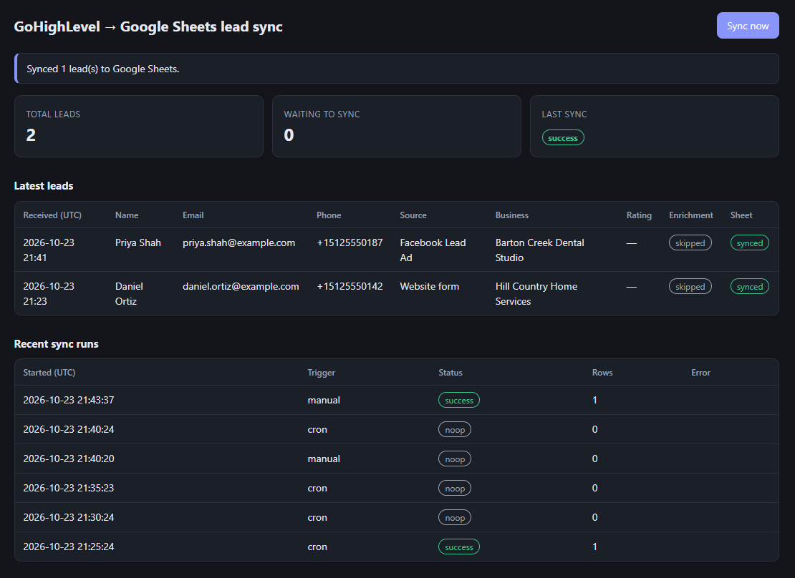

# GHL Lead Sync Worker

A Cloudflare Worker that turns GoHighLevel webhooks into a reliable lead pipeline:

1. A GoHighLevel workflow posts each new contact to the Worker.
2. The Worker validates it and stores it in a **D1** database (one row per contact, no duplicates).
3. Every 5 minutes a **scheduled job** looks up each new lead's business on **Google Places** (address, rating, reviews, website) and appends the leads to a **Google Sheet**.
4. A password-protected **admin page** shows recent leads and every sync run, with a "Sync now" button.

Built with Claude Code, in TypeScript, with no runtime dependencies — only Workers APIs.


*Admin page of the deployed Worker right after a manual sync: two test leads (fictional data) synced to Google Sheets, with Places enrichment off (`skipped`).*

## How it works

```
GHL workflow ──POST /webhooks/ghl?key=…──▶ Worker ──▶ D1: leads, sync_runs
                                              │        KV: de-dupe keys, Google token, Places cache
                                cron */5 ─────┼──▶ Google Places Text Search (optional enrichment)
                                              └──▶ Google Sheets API (append, RAW)
                                              │
                  browser ──GET /admin────────▶ dashboard (Basic auth)
```

| Endpoint | Purpose |
|---|---|
| `POST /webhooks/ghl` | Receives GHL webhooks. Secret via `?key=` or `x-webhook-secret` header. |
| `GET /admin` | Dashboard (Basic auth, password = `ADMIN_TOKEN`). |
| `POST /admin/sync` | Runs a sync immediately. |
| `GET /health` | Health check. |

## Reliability and security decisions

- **Idempotent:** contacts are upserted on `contact_id`, and identical retries within 10 minutes are skipped using KV. A contact is appended to the sheet once.
- **No data loss on failure:** leads are marked synced only after Google confirms the write. A failed run is logged in `sync_runs` and retried by the next cron tick.
- **Secrets:** compared in constant time, stored as Wrangler secrets, never logged.
- **Input limits:** 64 KB body limit, JSON shape validation, clear 4xx errors.
- **Safe output:** dashboard HTML is escaped and served with a strict Content-Security-Policy; Sheets writes use `RAW` so form input can't run as a formula.
- **Google auth without libraries:** the service-account JWT is signed with WebCrypto, and the access token is cached in KV for ~55 minutes.

## Google Places enrichment

> **Optional, and needs an active Google Cloud billing account.** The Places API (New) refuses requests (HTTP 403) until billing on the key's project is active, including while a free-trial prepayment is pending. Without `GOOGLE_PLACES_API_KEY` set, leads still sync to the sheet with enrichment `skipped`. If the key is set but billing isn't active, leads still sync, marked `failed`, so leave the secret unset until billing works (`npx wrangler secret delete GOOGLE_PLACES_API_KEY`).

When `GOOGLE_PLACES_API_KEY` is set, each sync run looks up pending leads' businesses with the [Places API (New) Text Search](https://developers.google.com/maps/documentation/places/web-service/text-search) before appending them to the sheet.

- **Query:** GHL's `company_name` plus `city` and `state` when present, e.g. `Acme Plumbing, Austin, TX`. The top match is stored.
- **Fields:** only `id`, `displayName`, `formattedAddress`, `rating`, `userRatingCount` and `websiteUri` are requested. Google bills by the most expensive field requested; rating, review count and website put each lookup on the **Text Search Enterprise** SKU.
- **Cost controls:** answers (including "not found") are cached in KV for 7 days by query, and at most `PLACES_MAX_PER_RUN` uncached lookups run per sync (default 25, maximum 40 to stay under the Workers Free plan's 50 subrequests per invocation). Leads over the cap wait for the next run, so they reach the sheet enriched.
- **Status per lead:** `found`, `not_found`, `skipped` (no company name, or no API key), `failed`, or `pending` (not looked up yet).
- **Never blocks the sync:** a Places error or 5-second timeout marks that lead `failed` and it syncs anyway. If the results can't be saved to D1, the run syncs its leads unenriched (`skipped`) so the sheet and D1 never disagree. The key is sent in a header, never in a URL, and is never logged.
- **Without a key** the sync works exactly as before; leads are marked `skipped` and the Places columns are left blank.

## Tests

38 tests run inside the real Workers runtime (Miniflare) with a real local D1 and KV:

```bash
npm install
npm run typecheck
npm test
```

They cover webhook auth, payload mapping, duplicates and updates, bad input, JWT signing (verified against a generated RSA key), Sheets success and failure paths, token caching and refresh, Places enrichment (found, not found, no key, errors, timeout, KV cache, no company, per-run cap), the 0002 data migration, dashboard auth and HTML escaping, and the cron handler. Google is never called from tests; an injected fake `fetch` stands in.

## Run locally

```bash
cp .dev.vars.example .dev.vars          # fill in values
npm run db:migrate:local
npx wrangler dev --test-scheduled

curl -X POST "http://localhost:8787/webhooks/ghl?key=YOUR_SECRET" \
  -H "content-type: application/json" \
  -d '{"contact_id":"demo_1","first_name":"Ana","email":"ana@example.com","contact_source":"Website form","company_name":"Acme Plumbing","city":"Austin","state":"TX"}'

curl http://localhost:8787/cdn-cgi/handler/scheduled   # trigger the cron
open http://localhost:8787/admin                        # any username, password = ADMIN_TOKEN
```

## Deploy

1. **Cloudflare resources**
   ```bash
   npx wrangler login
   npx wrangler d1 create ghl-leads            # paste database_id into wrangler.jsonc
   npx wrangler kv namespace create KV         # paste id into wrangler.jsonc
   npm run db:migrate:remote
   ```
2. **Google Sheet**
   - In Google Cloud Console, enable the Google Sheets API and create a service account with a JSON key.
   - Share your sheet with the service account's `client_email` as an Editor.
   - Add a `Leads` tab with headers:
     `Received, Contact ID, First name, Last name, Email, Phone, Source, Tags, Company, Address, City, State, Business name, Business address, Rating, Reviews, Website, Place ID, Enrichment`.
     (Upgrading? Add the 11 headers after `Tags`. Rows synced before the upgrade have those cells blank.)
   - Put the sheet ID (from its URL) in `SHEET_ID` in `wrangler.jsonc`.
3. **Google Places API key** (optional, for enrichment; skip this step until billing is active)
   - In the same Google Cloud project, make sure the project is linked to an **active** billing account (*Billing → Account management*), then enable **Places API (New)**.
   - Under *APIs & Services → Credentials*, create an API key.
   - Edit the key: under **API restrictions** choose *Restrict key* and select only **Places API (New)**. Leave *Application restrictions* at *None*: the Worker calls from Cloudflare's servers, so there's no fixed IP or referrer to pin it to.
   - Optionally set a daily quota on Places API (New) under *APIs & Services → Quotas* as a spending cap.
   - Tune `PLACES_MAX_PER_RUN` in `wrangler.jsonc` (default `25` lookups per sync run).
4. **Secrets**
   ```bash
   npx wrangler secret put GHL_WEBHOOK_SECRET
   npx wrangler secret put ADMIN_TOKEN
   npx wrangler secret put GOOGLE_SERVICE_ACCOUNT_JSON   # paste the whole JSON key
   npx wrangler secret put GOOGLE_PLACES_API_KEY         # optional; omit to turn enrichment off
   npm run db:migrate:remote                             # applies 0002 when upgrading
   npm run deploy
   ```
5. **GoHighLevel**: in a workflow (e.g. trigger *Contact Created* or *Form Submitted*), add a **Webhook** action with URL
   `https://ghl-lead-sync-worker.<your-subdomain>.workers.dev/webhooks/ghl?key=<GHL_WEBHOOK_SECRET>`.
   Enrichment reads `company_name` (or `companyName`), `city` and `state` from the payload; check that your webhook sends them.

## Project structure

```
src/index.ts     routing + cron handler
src/webhook.ts   auth, validation, GHL field mapping, de-dupe
src/db.ts        all D1 queries
src/sheets.ts    Google JWT auth + Sheets append
src/places.ts    Google Places lookup, KV cache, enrichment
src/sync.ts      batch sync logic
src/admin.ts     dashboard HTML
migrations/      D1 schema
test/            Vitest suites (Workers runtime)
CLAUDE.md        project rules for Claude Code
.claude/         typecheck hook + reviewer subagent
```

## Roadmap

- Update existing sheet rows when a contact changes, instead of append-only
- Stripe webhook to mark leads as paying customers
